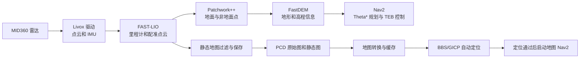

# 系统结构、完成情况与关键文件部署使用

本页说明仓库里有哪些主要部分、常用文件应该放在哪里，以及把程序放到另一台电脑时要重新准备什么。这里的“完成情况”指仓库中已有的功能入口和文档覆盖，不代表某台机器人已经通过现场验收。

## 当前完成情况

| 内容 | 仓库里已有的入口 | 运行前还要确认 |
| --- | --- | --- |
| MID360 驱动和传感器处理链 | `tool/start_board.sh` | 雷达和电脑网口 IP、供电、话题频率 |
| 新建地图并保存 PCD | `tool/start_fastlio_mapping.sh`，提供原始图和过滤后的静态图保存服务 | 现场是否覆盖完整、静态图是否采集足够观测 |
| 实时无图导航 | `tool/start_nav2.sh` | 雷达数据、传感器高度、CAN 与急停；只看软件时关闭底盘 |
| 已有地图导航 | `tool/start_map_navigation.sh`，根据 PCD 准备地图并先做自动定位 | PCD 是否对应当前场地、定位是否通过、外参与建图时是否一致 |
| 校准、录制、离线分析 | 对应的 `tool/` 脚本 | 校准姿态、录制磁盘空间、输入文件和话题是否匹配 |
| 原生安装和编译说明 | [环境准备与终端操作](环境准备与终端操作.md#install-build) | 每台目标电脑都需按自己的系统和硬件完成安装、编译与现场确认 |

目前仓库提供上述代码和运行入口；IP、雷达外参、CAN 状态和地图适配现场，需要在目标设备上确认。仅凭源码能编译或文档齐全，不能代替实机测试。

## 系统大致怎么连起来

简单理解：Livox 把雷达数据送进 ROS；FAST-LIO 用点云和 IMU 算机器人位置并累计点云；Patchwork++ 区分地面和非地面；FastDEM 产生供地形处理使用的信息；Nav2 根据当前路线和地图规划。新建地图时另存 PCD；使用已有 PCD 时，地图导航入口负责转换缓存和自动定位。

## 常用目录和文件

| 位置 | 放的是什么 | 平时怎么用 |
| --- | --- | --- |
| `src/livox_ros_driver2/config/MID360_config.json` | Livox 驱动的 MID360 网络配置 | 按现场修改雷达 IP 和电脑网卡 IP；备份并检查 JSON，改后重建 Livox 包。详见[设备接入与启动配置](设备接入与启动配置.md#mid360-network)。 |
| `src/FAST_LIO_ROS2/config/mid360.yaml` | FAST-LIO 的 MID360 参数 | 启动时通过 `config_file:=mid360.yaml` 选择；话题名和外参要与设备一致。外参只填写已标定的值。 |
| `src/bringup/config/nav2_theta_teb.yaml` | 无图导航的 Nav2 参数 | 无静态地图实时导航使用；日常优先通过 `tool/start_nav2.sh` 传启动参数。 |
| `src/bringup/config/nav2_map_navigation.yaml` | 已有地图导航的 Nav2 参数 | PCD 地图导航使用；不要和无图导航参数文件混为一份。 |
| `src/bringup/config/chassis_models.yaml` | 两种底盘的 footprint 与几何 profile | `chassis_model:=two_wheel|omni` 由两个导航 launch 读取；Nav2 主参数仍来自对应的基础 YAML。 |
| `src/bringup/config/fastdem_local.yaml` | FastDEM 的本地处理参数 | 由传感器处理和导航启动文件引用；修改地形参数前先确认输入和坐标系。 |
| `src/bringup/launch/` | ROS 2 启动文件，负责把各程序接起来 | 日常用 `tool/` 启动脚本；只有清楚所需参数时才直接 `ros2 launch`。 |
| `src/bringup/rviz/` | 项目自带的 RViz 显示配置 | 由启动文件选择。改显示方式不会修复缺失的点云或定位数据。 |
| `tool/` | 启动、建图、录制、校准和分析脚本 | 从仓库根目录运行；每个新手操作见[脚本与维护工具](脚本与维护工具.md)。 |
| `PCD/` | 保存的点云地图、地图转换缓存和录制数据 | 原始图一般留档；`clean_map.pcd` 通常作为地图导航输入。先确认磁盘空间。 |
| `build/`、`install/`、`log/` | 在当前电脑上编译生成的文件 | 由 `colcon` 使用，不手工编辑；换电脑后按目标机环境重新编译。 |
| `logs/` | 本项目启动脚本写出的运行日志 | 查启动错误时按时间找对应脚本的日志。 |

常用启动文件的职责如下。地图导航脚本会按顺序组合定位和导航启动文件；一般使用者直接运行左侧提到的 `tool/` 入口即可。

- `livox_fastlio_patchwork.launch.py`：Livox、FAST-LIO、Patchwork++ 和 FastDEM 处理链。
- `livox_fastlio_bringup.launch.py`：Livox 与 FAST-LIO 的建图链。
- `livox_fastlio_headless.launch.py`：不打开 RViz 的雷达与 FAST-LIO 链。
- `static_map_filter.launch.py`：单独启动静态地图过滤；一键建图会自动配置，不要重复启动。
- `nav2_theta_teb.launch.py`：实时无图导航入口。
- `map_navigation.launch.py`：已有地图导航阶段。
- `livox_fastlio_gicp_relocalization.launch.py`：在已有 PCD 上进行 BBS/GICP 定位。
- `navigation_core.launch.py`：地图导航内部的 FAST-LIO 与定位交接核心，由地图导航脚本管理。
- `calibrate_body_to_base.launch.py`：IMU 重力方向与机身安装角度校准。

### 两个容易混淆的文件

- `MID360_config.json` 管驱动连接哪台雷达、电脑网口使用哪个地址；它不等同于 FAST-LIO 的几何外参。
- `mid360.yaml` 里的 `lid_topic`、`imu_topic` 指 ROS 输入话题；`body_to_base_*` 和 `extrinsic_*` 是不同坐标关系的参数。没有标定依据时不要互相复制或随手改数值。

## 部署到另一台电脑或机器人主机

本项目按本机 Ubuntu/ROS 环境编译运行，没有单独的 Docker 镜像部署步骤，也没有一个命令能替所有设备设置 IP、外参和 CAN。每台目标主机按自己的系统、架构和传感器单独准备。

### 1. 在目标主机准备环境并取得代码

先按[环境准备与终端操作](环境准备与终端操作.md)安装 ROS 2、依赖和 Livox SDK，再在目标主机下载代码。若目标主机还没有仓库，可在终端运行：

~~~bash
cd /home/nvidia
git clone https://github.com/VLAIRobotics/navigation.git
cd /home/nvidia/navigation
~~~

如果仓库需要账号权限，应先确认该账号获准访问，并按组织批准的 Git 登录方式操作。不要把密码或访问令牌粘进命令。已有仓库就直接进入原目录，不要重复克隆。

在目标主机本地按环境文档编译。不要把另一台电脑生成的 `build/`、`install/`、`log/` 当作源码复制过去使用；这些目录是本机编译结果，目标主机应使用自己的系统和处理器重新生成。

### 2. 放好设备配置和地图

1. 在目标主机上按现场网络设置电脑雷达网卡，并修改 `MID360_config.json`。设置方法见[设备接入与启动配置](设备接入与启动配置.md#mid360-network)。改完后重建 Livox 驱动包。
2. 检查 `mid360.yaml` 的输入话题与实际驱动一致。雷达和机身的外参应来自这台机器的标定记录，不要直接使用另一台车的数据。
3. 如果要使用已有地图，把对应场地的 PCD 文件复制到目标仓库的 `PCD/` 文件夹。没有此目录时，在仓库根目录运行：

   ~~~bash
   mkdir -p PCD
   ~~~

   然后用 Ubuntu“文件”窗口把地图复制到该文件夹。也可以将 PCD 留在其他目录，启动时给 `pcd_file:=` 填完整路径。
4. 确认地图不是空文件，并且确实来自当前场地：

   ~~~bash
   ls -lh PCD/clean_map.pcd
   ~~~

   显示文件大小且大于 0 字节只是第一步；地图是否完整，还要在 RViz 和定位流程中检查。

地图导航的转换结果和缓存由 `tool/start_map_navigation.sh` 自动生成或复用。通常只要部署原始 PCD，不用手工拼装转换出来的 `.yaml`、`.pgm` 和地形文件；如果强制重建，使用该脚本的 `rebuild_map:=true` 参数。

底盘模型通过 `chassis_model:=two_wheel|omni` 选择，切回双轮可省略参数或显式写 `chassis_model:=two_wheel`。无图入口使用 `nav2_theta_teb.yaml`，地图入口使用 `nav2_map_navigation.yaml`；launch 根据 `chassis_models.yaml` 改写 footprint、横移规划限值和平滑器参数。当前 profile 的双轮尺寸为 0.625 × 0.45 m，全向为 0.625 × 0.625 m。启动日志 `Chassis model=... footprint=... profile=...` 可核对所选模型。全向 CAN 横移字段仍待协议确认，驱动目前会拒绝在全向模式下打开底盘 CAN；不要把全向规划配置误认为全向驱动已可用。

### 3. 先验证传感器，再运行任务

在目标主机先完成[传感器检查](传感器建图与校准.md#sensor-check)，确认点云、IMU 和 `/Odometry` 有数据，再选择[建图](传感器建图与校准.md#mapping-save)、[实时导航](Nav2导航与RViz操作.md#no-map-navigation)或[已有地图导航](Nav2导航与RViz操作.md#map-navigation)。

第一次查看定位和规划时，导航命令要明确传 `enable_chassis:=false`。确认系统、网络和急停前，不要尝试让真车移动。具体启动、停止和检查步骤按各自流程页执行。

## 部署后怎么看是否已经就绪

- 传感器处理：`ros2 topic hz /livox/lidar` 和 `ros2 topic hz /Odometry` 能持续显示频率。
- 新建地图：`/map_save` 和 `/static_map_save` 都返回 `success: true`，且 `PCD/` 下生成大小大于 0 的 PCD。
- 已有地图导航：程序完成地图转换并通过定位交接后，才在 RViz 里发送导航目标。
- 底盘控制：由硬件负责人单独确认 CAN、急停和速度标定后再开放。

任何一项未达到预期时，先按[常见问题检查与解决](常见问题检查与解决.md)排查并保存日志；不要用“节点启动了”代替数据和定位验收。
